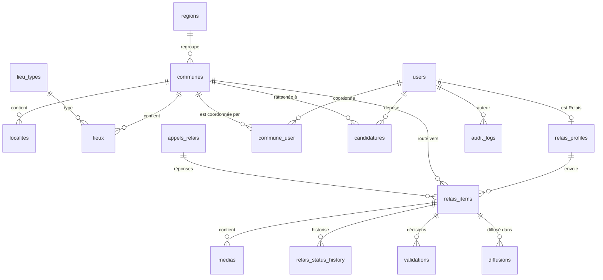

# Modèle de données — v1, étape 0

Conventions : clé primaire `id` (bigint, interne) + `uuid` exposé ; géométries en SRID 4326 ; horodatages UTC.
✅ = table créée · ◻ = prévue (étape indiquée).

## Tables

| Table | Rôle | Colonnes clés | Étape |
|---|---|---|---|
| `regions` ✅ | Région, rattachée à un district | `name`, `slug`, `district`, `code` | 0 |
| `communes` ✅ | Niveau de rattachement obligatoire | `region_id`, `geom` MultiPolygon (GIST), `is_virtual`, `is_active` | 0 |
| `localites` ✅ | Quartier, village, sous-préfecture | `commune_id`, `type`, `location` Point | 0 |
| `lieu_types` ✅ / `lieux` ✅ | École, université, marché… | `lieu_type_id`, `commune_id`, `location` | 0 |
| `users` ✅ | Compte | `phone` chiffré, `phone_hash` (HMAC, unique), `email`, `status`, colonnes 2FA Fortify | 1 |
| `personal_access_tokens` ✅ | Jetons Sanctum par appareil | — | 0 |
| `roles`, `permissions`, … ✅ | spatie/laravel-permission | — | 0 |
| `commune_user` ✅ / `region_user` ✅ | Coordonnateurs par commune, superviseurs par région | `assignment` (titulaire, suppléant) | 1 |
| `otp_codes` ✅ | Codes SMS hachés | `phone_hash`, `code_hash`, `expires_at`, `attempts` | 1 |
| `devices` ✅ | Appareils, jetons push | `user_id`, `fcm_token`, `platform`, `revoked_at` | 1 |
| `audit_logs` ✅ | Journal non modifiable | `actor_id`, `action`, `subject_type/id`, `payload` jsonb, `ip`, `prev_hash`, `hash` | 1 |
| `settings` ✅ | Paramètres plateforme | `key`, `value` jsonb | 1 |
| `candidatures` ◻ | Dossier de candidature | `user_id`, `commune_id`, `status`, `step`, champs MOB-02 | 2 |
| `candidature_documents` ◻ | Pièces (disque `identity`) | `type`, `path`, `sha256` | 2 |
| `legal_documents` / `consents` ◻ | Textes versionnés et acceptations | `version`, `accepted_at`, `ip` | 2 |
| `formations` / `quiz_*` ◻ | Formation et quiz | `score`, `passed` | 2 |
| `relais_profiles` ◻ | Le Relais (observateur) | `user_id`, `number`, `commune_id`, `lieu_id`, `reliability` | 2 |
| `relais_items` ◻ | Le relais (contenu) | `client_uuid` (unique), `state`, `urgency`, `category_id`, `commune_id`, `location` Point, `device_captured_at`, `received_at`, protections | 3 |
| `medias` / `media_variants` ◻ | Fichiers et versions | `disk`, `path`, `mime`, `size`, `sha256`, `phash`, `is_imported` | 3 |
| `relais_status_history` ◻ | Transitions d'état | `from`, `to`, `actor_id`, `reason` | 3 |
| `validations` ◻ | Décisions coordonnateur | `decision`, `rejection_reason_id`, `blur_required`, `corrections` jsonb | 3 |
| `categories` / `rejection_reasons` ✅ | Listes paramétrables (Annexe B, COO-15) | — | 1 |
| `appels_relais` ◻ | Appels de la rédaction | `target` (communes, régions, rayon `geom`), `deadline` | 4 |
| `selections`, `diffusions`, `collections`, `export_logs` ◻ | Exploitation éditoriale | — | 4 |
| `conversations` / `messages` ◻ | Messagerie | — | 4 |

## Règles

- Toute donnée communale porte `commune_id` indexé : c'est la clé du `CommuneScope`.
- `relais_items.commune_id` = commune déduite du GPS (`ResolveCommuneFromPoint`), sinon commune déclarée.
- Données personnelles sensibles chiffrées (cast `encrypted`) ; recherche par empreinte HMAC.
- Contours officiels importés avec `php artisan territoire:import-communes` (fichier fourni par REFLET TV).
